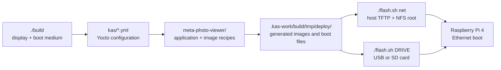

# Project directory guide

This guide maps the **source repository**, the **generated build files**, and
the **files used when the Raspberry Pi boots**. Paths are relative to the
repository root unless they begin with `/`.

## At a glance



## Tracked source tree

```text
photo_viewer/
├── README.md                     Project overview, usage, hardware notes
├── DIRECTORY_STRUCTURE.md        This map
├── CHANGELOG.md                  Release and validation history
├── LICENSE                       Project license
├── build                         Select display/medium and create an image
├── flash.sh                      Deploy the last successful build
├── kas/                          Build profiles (see matrix below)
│   ├── rpi4-photo-viewer.yml     Base 4.3-inch DSI, USB profile
│   ├── rpi4-photo-viewer-sd.yml  4.3-inch DSI, SD profile
│   ├── rpi4-photo-viewer-net.yml 4.3-inch DSI, network profile
│   ├── rpi4-photo-viewer-7inch.yml
│   ├── rpi4-photo-viewer-7inch-sd.yml
│   ├── rpi4-photo-viewer-7inch-net.yml
│   ├── rpi4-photo-viewer-hdmi.yml
│   ├── rpi4-photo-viewer-hdmi-sd.yml
│   └── rpi4-photo-viewer-hdmi-net.yml
├── meta-photo-viewer/            Custom Yocto layer
│   ├── conf/layer.conf           Register this layer with BitBake
│   ├── recipes-apps/photo-viewer/
│   │   ├── photo-viewer_2.0.bb   Build/install the gallery application
│   │   └── files/               C sources, web page, service files
│   ├── recipes-core/images/
│   │   └── photo-viewer-image.bb Define packages in the Pi root filesystem
│   ├── recipes-graphics/lvgl/    LVGL recipe additions and patches
│   ├── recipes-support/imagemagick/
│   │                              ImageMagick format support additions
│   └── wic/usb-raspberrypi.wks   USB image partition layout
└── netboot/                      Host-side network boot setup and deployment
    ├── setup-host.sh             Configure host Ethernet, DHCP/TFTP, NFS
    ├── dnsmasq.conf              Private DHCP/TFTP configuration for eno1
    ├── photo-viewer-netboot-dnsmasq.service
    ├── deploy.sh                 Install a built network boot bundle
    ├── diagnose.sh               Enable/remove Pi boot log collection
    ├── photo-viewer-boot-diagnostics
    └── photo-viewer-boot-diagnostics.service
```

The 4.3-inch profile is the base KAS file. The other KAS profiles include it
or another display profile, then change the display, boot medium, image name,
and kernel command line as needed. `./build` chooses the matching profile:

| Command | KAS profile suffix | Output |
| --- | --- | --- |
| `./build 4_3_display [usb\|sd\|net]` | base, `-sd`, `-net` | 800 × 480 DSI |
| `./build 7_display [usb\|sd\|net]` | `-7inch`, `-7inch-sd`, `-7inch-net` | 1024 × 600 DSI |
| `./build hdmi_display [usb\|sd\|net]` | `-hdmi`, `-hdmi-sd`, `-hdmi-net` | HDMI monitor |

`usb` is the default medium when the second argument is omitted. USB and SD
builds create compressed WIC disk images. Network builds create a bundle with
the root filesystem archive and matching TFTP boot files.

## Application files inside the Yocto layer

```text
meta-photo-viewer/recipes-apps/photo-viewer/files/
├── main.c                         LVGL screens, gallery, input handling
├── display_layout.h               Display-dependent sizes and layout values
├── camera_backend.c/.h            Video4Linux2 camera capture
├── camera_ui.c/.h                 Camera screen and capture controls
├── image_convert.c/.h            Decode and prepare images for display
├── image_settings.c/.h           Saved per-image rotation and Fit/Fill
├── media_server.c/.h             HTTP photo manager
├── index.html                    Browser interface
├── wifi_control.c/.h             Wi-Fi scan and connection control
├── hostname_settings.c/.h        Editable local hostname
├── photo-viewer.service          Start the gallery after framebuffer setup
├── photo-viewer-wifi.service     Start Wi-Fi authentication
├── photo-viewer-wpa.conf         Initial Wi-Fi configuration
├── 20-photo-viewer-wlan.network  WLAN DHCP configuration
├── panel-simple.conf            4.3-inch panel module loading
└── Makefile                     Compile the application for the Pi
```

The `.bb` recipe installs these files into the Pi image; editing `files/`
alone does not update an already deployed Pi. Rebuild and redeploy the image
to apply application changes.

## Generated files and Pi storage

These paths are produced by tools or by the running Pi. They are outside Git
and should not be confused with the source files above.

| Path | Purpose |
| --- | --- |
| `.kas-work/` | Downloaded Yocto layers, build state, caches, and artifacts. |
| `.kas-work/build/latest-image.tsv` | Display, medium, filename, and checksum of the latest successful `./build`; `flash.sh` reads it. |
| `.kas-work/build/tmp/deploy/images/raspberrypi4-64/` | Compressed USB/SD images, network boot bundles, kernel, firmware, and device-tree files. |
| `/srv/photo-viewer-netboot/tftp/` on the host | Pi firmware, kernel, command line, and display overlays served by TFTP. |
| `/srv/photo-viewer-netboot/rootfs/` on the host | Pi root filesystem exported over NFS. |
| `/opt/photo-viewer/photos/` on the Pi | Gallery photos; network boot stores them in the host NFS root. |
| `/opt/photo-viewer/camera.conf` on the Pi | Saved camera mode. |
| `/etc/photo-viewer-wpa.conf` on the Pi | Saved Wi-Fi profiles. |

The `netboot/setup-host.sh` script installs the host service configuration
under `/etc/photo-viewer-netboot/`, `/etc/exports.d/`, and systemd. The
`netboot/deploy.sh` script replaces the host TFTP and NFS directories while
preserving gallery photos and saved device settings. Keep the host running
while the Pi uses network boot.

The repository ignores `.kas-work/`, downloaded layers, build artifacts, and
the downloaded `kas-container` wrapper. A fresh checkout regenerates them on
the first build; Git contains the recipes and scripts needed to do so.
